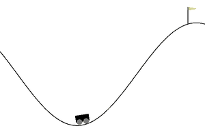

# Classic control

The five classic-control benchmarks, with the same IDs, time limits and reward thresholds as
gymnasium. They need only NumPy.

!!! success "Bit-identical to gymnasium"
    Dynamics, rewards, termination, reset distributions and seeding match gymnasium's
    implementations exactly: with the same seed and actions, observations and rewards are
    equal to the last bit. sekai's test suite checks this against gymnasium on every CI run,
    so results from the literature carry over directly.

```python
import gymnasium as gym
import numpy as np
import sekai

for env_id in ["CartPole-v1", "MountainCar-v0", "MountainCarContinuous-v0",
               "Pendulum-v1", "Acrobot-v1"]:
    ours, theirs = sekai.make(env_id), gym.make(env_id)
    ours.action_space.seed(0)
    result = ours.reset(seed=0)
    obs, _ = theirs.reset(seed=0)
    identical = np.array_equal(result.observation, obs)
    while not result.done:
        action = ours.action_space.sample()
        result = ours.step(action)
        obs, reward, terminated, truncated, _ = theirs.step(action)
        identical &= (np.array_equal(result.observation, obs) and result.reward == reward
                      and result.terminated == terminated and result.truncated == truncated)
    print(f"{env_id:25s} identical: {identical}")
```

```text
CartPole-v1               identical: True
MountainCar-v0            identical: True
MountainCarContinuous-v0  identical: True
Pendulum-v1               identical: True
Acrobot-v1                identical: True
```

Each environment has an RGB [renderer](../guide/rendering.md) in
`sekai.envs.classic_control`, which produced the animations on this page.

## CartPole-v1

{ .sk-env-preview loading=lazy }

Balance a pole on a cart by pushing the cart left or right (Barto, Sutton & Anderson, 1983).
Class: `sekai.envs.CartPoleEnv`.

| Observation (`Box(4,)`, `float32`) | Range |
|---|---|
| 0: cart position | $[-4.8, 4.8]$ |
| 1: cart velocity | $(-\infty, \infty)$ |
| 2: pole angle (rad) | $[-0.419, 0.419]$ (±24°) |
| 3: pole angular velocity | $(-\infty, \infty)$ |

| Action (`Discrete(2)`) | |
|---|---|
| 0 | push the cart left |
| 1 | push the cart right |

| | |
|---|---|
| Reward | $+1$ every step, including the terminating one. With `sutton_barto_reward=True`: $0$ per step and $-1$ on termination |
| Start | every state variable uniform in $[-0.05, 0.05]$ |
| Termination | pole angle beyond ±12° or cart position beyond ±2.4 |
| Truncation | 500 steps (`TimeLimit` from the registry) |
| Reward threshold | 475 |
| Reset options | `{"low": ..., "high": ...}` overrides the start range |
| Constructor | `CartPoleEnv(sutton_barto_reward=False)` |
| Renderer | `CartPoleRenderer(width=600, height=400)` |

Stepping after termination without a reset gives reward 0 (or $-1$ with
`sutton_barto_reward`) and a warning, as in gymnasium.

## MountainCar-v0

{ .sk-env-preview loading=lazy }

Drive an under-powered car up the right-hand hill by building momentum (Moore, 1990).
Class: `sekai.envs.MountainCarEnv`.

| Observation (`Box(2,)`, `float32`) | Range |
|---|---|
| 0: position | $[-1.2, 0.6]$ |
| 1: velocity | $[-0.07, 0.07]$ |

| Action (`Discrete(3)`) | |
|---|---|
| 0 | accelerate left |
| 1 | no acceleration |
| 2 | accelerate right |

Dynamics: $v_{t+1} = v_t + (a - 1)\cdot 0.001 - 0.0025\cos(3x_t)$, clipped to the velocity
range, then $x_{t+1} = x_t + v_{t+1}$, clipped to the position range (hitting the left wall
zeroes the velocity).

| | |
|---|---|
| Reward | $-1$ per step |
| Start | position uniform in $[-0.6, -0.4]$, velocity 0 |
| Termination | position $\ge 0.5$ and velocity $\ge$ `goal_velocity` |
| Truncation | 200 steps |
| Reward threshold | $-110$ |
| Reset options | `{"low": ..., "high": ...}` overrides the start position range |
| Constructor | `MountainCarEnv(goal_velocity=0.0)` |
| Renderer | `MountainCarRenderer(width=600, height=400)` |

## MountainCarContinuous-v0

{ .sk-env-preview loading=lazy }

Mountain car with a continuous force. Class: `sekai.envs.ContinuousMountainCarEnv`.

| | |
|---|---|
| Observation | as `MountainCar-v0` |
| Action | `Box(-1, 1, (1,), float32)`: force, clipped to $[-1, 1]$ and scaled by 0.0015 |
| Reward | $-0.1\,a^2$ per step (unclipped action), $+100$ on reaching the goal |
| Start | position uniform in $[-0.6, -0.4]$, velocity 0 |
| Termination | position $\ge 0.45$ and velocity $\ge$ `goal_velocity` |
| Truncation | 999 steps |
| Reward threshold | 90 |
| Reset options | `{"low": ..., "high": ...}` overrides the start position range |
| Constructor | `ContinuousMountainCarEnv(goal_velocity=0.0)` |
| Renderer | `MountainCarRenderer` (draws both variants) |

Like gymnasium's, the state is stored as `float32` after the first step.

## Pendulum-v1

{ .sk-env-preview loading=lazy }

Swing a pendulum up and keep it upright with limited torque. Class: `sekai.envs.PendulumEnv`.

| Observation (`Box(3,)`, `float32`) | Range |
|---|---|
| 0: $\cos\theta$ | $[-1, 1]$ |
| 1: $\sin\theta$ | $[-1, 1]$ |
| 2: angular velocity $\dot\theta$ | $[-8, 8]$ |

| | |
|---|---|
| Action | `Box(-2, 2, (1,), float32)`: torque $u$ |
| Reward | $-(\theta^2 + 0.1\,\dot\theta^2 + 0.001\,u^2)$ with $\theta$ normalised to $[-\pi, \pi]$, 0 upright; range $[-16.27, 0]$ |
| Start | $\theta$ uniform in $[-\pi, \pi]$, $\dot\theta$ uniform in $[-1, 1]$ |
| Termination | none |
| Truncation | 200 steps |
| Reward threshold | none |
| Reset options | `{"x_init": ..., "y_init": ...}`: symmetric bounds for $\theta$ and $\dot\theta$ |
| Constructor | `PendulumEnv(g=10.0)` |
| Renderer | `PendulumRenderer(size=500)` |

## Acrobot-v1

{ .sk-env-preview loading=lazy }

Swing the tip of a two-link pendulum above a line by applying torque at the middle joint
(Sutton, 1996; "book" dynamics, RK4 integration with $\Delta t = 0.2$).
Class: `sekai.envs.AcrobotEnv`.

| Observation (`Box(6,)`, `float32`) | Range |
|---|---|
| 0, 1: $\cos\theta_1$, $\sin\theta_1$ | $[-1, 1]$ |
| 2, 3: $\cos\theta_2$, $\sin\theta_2$ | $[-1, 1]$ |
| 4: $\dot\theta_1$ | $[-4\pi, 4\pi]$ |
| 5: $\dot\theta_2$ | $[-9\pi, 9\pi]$ |

| | |
|---|---|
| Action | `Discrete(3)`: torque $-1$, $0$ or $+1$ on the actuated joint |
| Reward | $-1$ per step, $0$ on the terminating step |
| Start | every state variable uniform in $[-0.1, 0.1]$ |
| Termination | $-\cos\theta_1 - \cos(\theta_1 + \theta_2) > 1$ |
| Truncation | 500 steps |
| Reward threshold | $-100$ |
| Reset options | `{"low": ..., "high": ...}` overrides the start range |
| Constructor | `AcrobotEnv()` |
| Renderer | `AcrobotRenderer(size=500)` |

## Options and constructor arguments

Constructor arguments go through `make()`; per-episode settings go through `reset()`:

```python
env = sekai.make("CartPole-v1", sutton_barto_reward=True)
print(env.reset(seed=0, options={"low": -0.2, "high": 0.2}).observation)  # [ 0.05478467 -0.09208532 -0.18361059 -0.19338894]

pendulum = sekai.make("Pendulum-v1", g=9.81)
print(pendulum.reset(seed=0, options={"x_init": 0.1, "y_init": 0.1}).observation)  # [ 0.99962485  0.02738891 -0.04604266]
```

All five environments raise `ResetRequired` when stepped before `reset()`, and the discrete
ones raise `InvalidAction` for actions outside their action space.
