# Environment catalog

Twenty-two environments are registered when `sekai` is imported. Build any of them with
`sekai.make(id)`; keyword arguments go to the environment's constructor.

| ID | Observation space | Action space | Horizon | Reward threshold |
|---|---|---|---|---|
| [`CartPole-v1`](classic-control.md#cartpole-v1) | `Box(4,)` | `Discrete(2)` | 500 (truncation) | 475 |
| [`MountainCar-v0`](classic-control.md#mountaincar-v0) | `Box(2,)` | `Discrete(3)` | 200 (truncation) | −110 |
| [`MountainCarContinuous-v0`](classic-control.md#mountaincarcontinuous-v0) | `Box(2,)` | `Box(-1, 1, (1,))` | 999 (truncation) | 90 |
| [`Pendulum-v1`](classic-control.md#pendulum-v1) | `Box(3,)` | `Box(-2, 2, (1,))` | 200 (truncation) | — |
| [`Acrobot-v1`](classic-control.md#acrobot-v1) | `Box(6,)` | `Discrete(3)` | 500 (truncation) | −100 |
| [`Trading-v0`](finance.md#trading-v0) | `Box(lookback + 1,)` | `Discrete(len(positions))` | `episode_length` = 252 (truncation) | — |
| [`Portfolio-v0`](finance.md#portfolio-v0) | `Dict(returns: Box(lookback, n), weights: Box(n + 1,))` | `Box(0, 1, (n + 1,))`, or `Box(-1, 1, (n,))` with shorts | `episode_length` = 252 (truncation) | — |
| [`Trading-v1`, `Portfolio-v1`](finance.md#options-shared-by-trading-v0-and-portfolio-v0) | as v0, plus the pending order | as v0 | as v0 | — |
| [`MarketMaking-v0`](finance.md#marketmaking-v0) | `Box(2,)` | `Box(0, max_offset, (2,))` | `n_steps` = 200 (termination) | — |
| [`OptimalExecution-v0`](finance.md#optimalexecution-v0) | `Box(3,)` | `Box(0, 1, (1,))` | `n_steps` = 25 (termination) | — |
| [`Market-v0`](finance.md#market-v0) | `Dict(assets: MaskedBox(lookback, F) × max_assets, portfolio: Box(max_assets + 1,), account: Box(2,))` | `Box(0, 1, (max_assets + 1,))`, or `Box(-1, 1, (max_assets,))` with shorts | `episode_length` = 252 (truncation) | — |
| [`Market-v1`](finance.md#market-v1) | as `Market-v0`, plus `pending: Box(max_assets + 1,)` with next-close execution (any `ObservationBuilder`) | as `Market-v0` (any `ActionMap`) | `episode_length` = 252 (truncation) | — |
| [`LimitOrderBook-v0`](finance.md#limitorderbook-v0) | `Dict(book: Box(levels, 4), trades: MaskedBox(3,) × max_trades, agent: Box(6,))` | `MultiDiscrete([K + 1, K + 1, 3])` | `n_steps` = 300 (termination) | — |
| [`Chess-v0`, `ChessVsRandom-v0`](games.md#chess) | `Box(0, 1, (119, 8, 8))` | `Discrete(4672)` | a game; 512 plies (truncation) | — |
| [`Go9x9-v0`, `Go13x13-v0`, `Go19x19-v0`](games.md#go) | `Box(0, 1, (17, N, N))` | `Discrete(N² + 1)` | two passes, or 3N² moves (scored either way) | — |
| [`Xiangqi-v0`](games.md#xiangqi) | `Box(0, 1, (131, 10, 9))` | `Discrete(8100)` | a game; 400 plies (truncation) | — |
| [`HeadsUpHoldem-v0`](games.md#heads-up-no-limit-holdem) | `Box(125,)` | `Discrete(7)` | one hand (termination) | — |
| [`Blackjack-v0`](games.md#blackjack) | `Box(43,)` | `Discrete(9)` | one round (termination) | — |

All observation and action `Box`es are `float32`. For the classic-control environments the
horizon is a `TimeLimit` added by `make()` (override it with `make(id, max_episode_steps=N)`),
as are the ply limits of chess and xiangqi; the finance environments and the other games
end their own episodes, so `make()` adds no wrapper.

`Trading-v0/v1`, `Portfolio-v0/v1`, `Market-v1`, `MarketMaking-v0` and `OptimalExecution-v0`
also have [native vector implementations](finance.md#native-vector-environments) that step every
sub-env with array operations, typically 20× faster than a `SyncVecEnv`.
`sekai.make_vec(id, n)` uses them by default, and `sekai list` marks them `[native vec]`.

```python
import sekai

for spec in sekai.all_specs():
    env = sekai.make(spec.id)
    print(f"{spec.id:25s} {env.observation_space}")
```

```text
CartPole-v1               Box([-4.8, -inf, -0.41887903, -inf], [4.8, inf, 0.41887903, inf], (4,), float32)
MountainCar-v0            Box([-1.2, -0.07], [0.6, 0.07], (2,), float32)
MountainCarContinuous-v0  Box([-1.2, -0.07], [0.6, 0.07], (2,), float32)
Pendulum-v1               Box([-1.0, -1.0, -8.0], [1.0, 1.0, 8.0], (3,), float32)
Acrobot-v1                Box([-1.0, -1.0, -1.0, -1.0, -12.566371, -28.274334], [1.0, 1.0, 1.0, 1.0, 12.566371, 28.274334], (6,), float32)
Trading-v0                Box(-inf, [inf, inf, inf, ..., inf, inf, 1.0], (31,), float32)
Portfolio-v0              Dict({returns: Box(-inf, inf, (30, 5), float32), weights: Box(0.0, 1.0, (6,), float32)})
Trading-v1                Box([-inf, -inf, -inf, ..., -inf, -inf, -1.0], [inf, inf, inf, ..., inf, 1.0, 1.0], (32,), float32)
Portfolio-v1              Dict({returns: Box(-inf, inf, (30, 5), float32), weights: Box(0.0, 1.0, (6,), float32), pending: Box(0.0, 1.0, (6,), float32)})
MarketMaking-v0           Box([-1.0, 0.0], 1.0, (2,), float32)
OptimalExecution-v0       Box([0.0, 0.0, -inf], [1.0, 1.0, inf], (3,), float32)
Market-v0                 Dict({assets: MaskedBox(-inf, inf, (20, 2), max_size=10, float32), portfolio: Box(-inf, inf, (11,), float32), account: Box(-inf, inf, (2,), float32)})
Market-v1                 Dict({assets: MaskedBox(-inf, inf, (20, 2), max_size=10, float32), portfolio: Box(-inf, inf, (11,), float32), account: Box(-inf, inf, (2,), float32), pending: Box(-inf, inf, (11,), float32)})
LimitOrderBook-v0         Dict({book: Box(-inf, inf, (5, 4), float32), trades: MaskedBox(-inf, inf, (3,), max_size=16, float32), agent: Box(-inf, inf, (6,), float32)})
```

(A `Box` prints its overall minimum and maximum bound; see each environment's page for the
per-dimension ranges.)

## Classic control

<div class="sk-gallery" markdown>
<figure markdown>
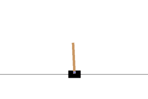{ loading=lazy }
<figcaption>CartPole-v1</figcaption>
</figure>
<figure markdown>
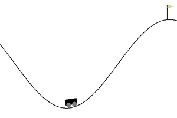{ loading=lazy }
<figcaption>MountainCar-v0</figcaption>
</figure>
<figure markdown>
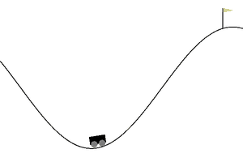{ loading=lazy }
<figcaption>MountainCarContinuous-v0</figcaption>
</figure>
<figure markdown>
{ loading=lazy }
<figcaption>Pendulum-v1</figcaption>
</figure>
<figure markdown>
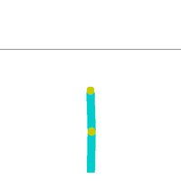{ loading=lazy }
<figcaption>Acrobot-v1</figcaption>
</figure>
</div>

The standard control benchmarks, [bit-identical to gymnasium](classic-control.md), with
NumPy-only RGB renderers.

## Finance

=== "Qian Capital (default)"

    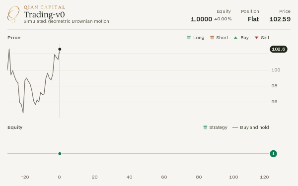{ loading=lazy title="TradingRenderer" }
    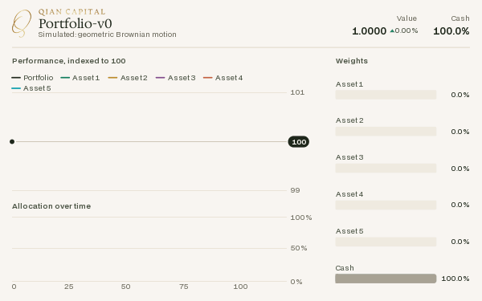{ loading=lazy title="PortfolioRenderer" }
    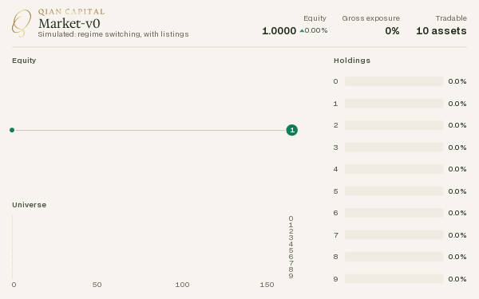{ loading=lazy title="MarketRenderer" }
    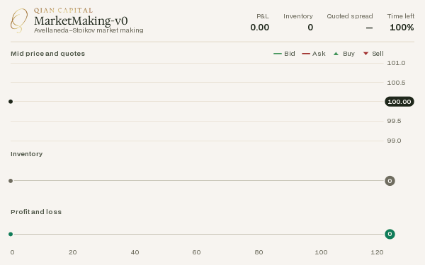{ loading=lazy title="MarketMakingRenderer" }
    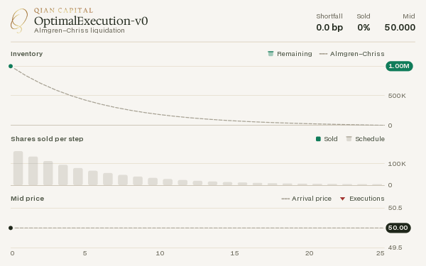{ loading=lazy title="OptimalExecutionRenderer" }
    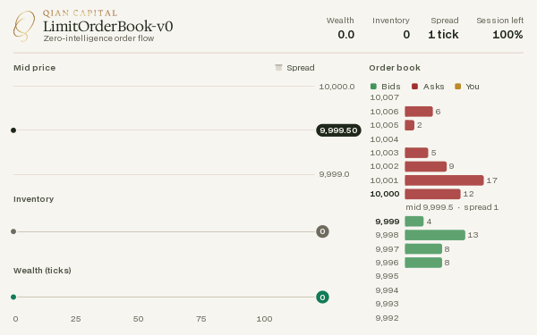{ loading=lazy title="LimitOrderBookRenderer" }
    { .sk-dashboards }

=== "Plain (branding=False)"

    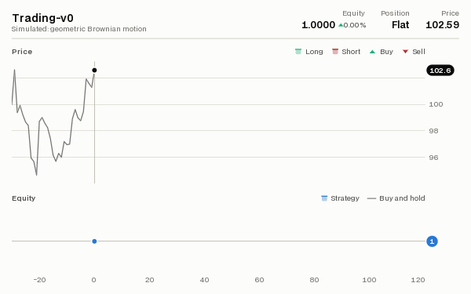{ loading=lazy title="TradingRenderer" }
    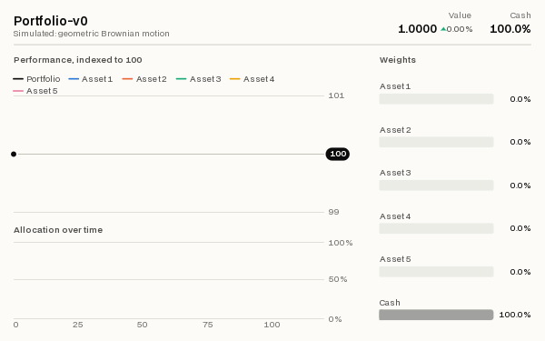{ loading=lazy title="PortfolioRenderer" }
    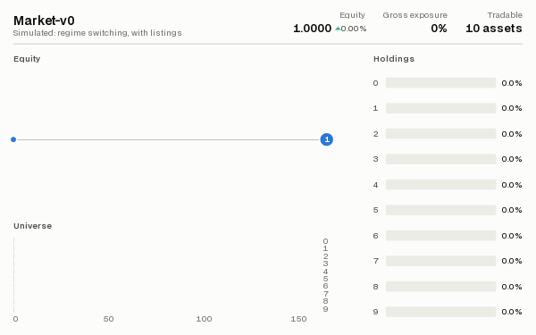{ loading=lazy title="MarketRenderer" }
    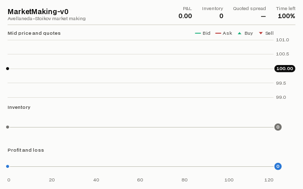{ loading=lazy title="MarketMakingRenderer" }
    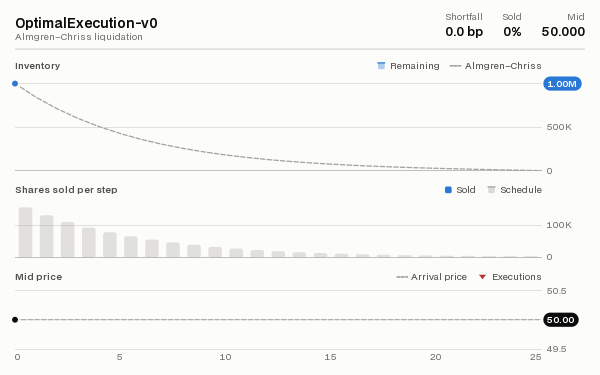{ loading=lazy title="OptimalExecutionRenderer" }
    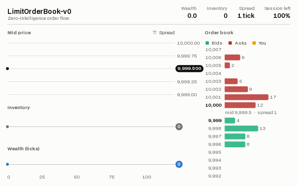{ loading=lazy title="LimitOrderBookRenderer" }
    { .sk-dashboards }

Each is drawn by its renderer in `sekai.envs.finance`, with the Qian Capital header or, with
`branding=False`, the plain one of sekai 0.2 ([Rendering](../guide/rendering.md#branding)).

| Environment | You control | The baseline to beat |
|---|---|---|
| [`Trading-v0`](finance.md#trading-v0) | a target position in one asset | buy and hold |
| [`Portfolio-v0`](finance.md#portfolio-v0) | weights across assets and cash | equal weight, inverse volatility |
| [`MarketMaking-v0`](finance.md#marketmaking-v0) | bid and ask distances from the mid | Avellaneda–Stoikov closed-form quotes |
| [`OptimalExecution-v0`](finance.md#optimalexecution-v0) | how much of a large order to sell each period | the Almgren–Chriss optimal schedule |
| [`Market-v0`](finance.md#market-v0) | weights across a universe whose members list and delist, with costs, leverage and financing | equal weight; an oracle that sees the market regime |
| [`Market-v1`](finance.md#market-v1) | the same, filling at the next close, with constraints, holding costs and risk models; batched on NumPy or torch | the [benchmark baselines](../finance/benchmarks.md) |
| [`LimitOrderBook-v0`](finance.md#limitorderbook-v0) | bid and ask levels and market orders in a limit order book | inventory-skewed quotes |

`Trading-v0`, `Portfolio-v0` and `Market-v0` run on simulated markets or on
[your own price history](finance.md#your-own-price-history).
[`LimitOrderBookMarket`](finance.md#limitorderbookmarket) is a multi-agent order book (not
registered; construct it from `sekai.envs.finance`). The components they are built from
are documented in the [finance toolkit](../finance/index.md). Each has a
[renderer](../guide/rendering.md#finance) that draws its episodes as a dashboard.

## Strategy games

<div class="sk-gallery" markdown>
<figure markdown>
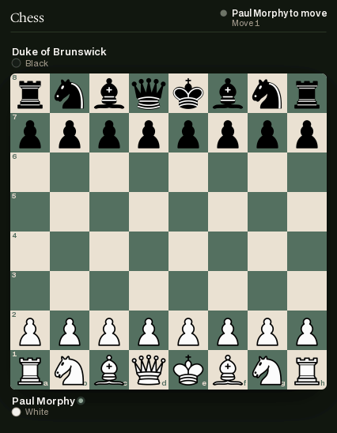{ loading=lazy }
<figcaption>Chess-v0</figcaption>
</figure>
<figure markdown>
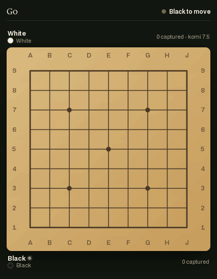{ loading=lazy }
<figcaption>Go9x9-v0</figcaption>
</figure>
<figure markdown>
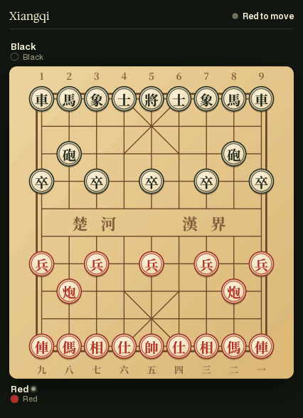{ loading=lazy }
<figcaption>Xiangqi-v0</figcaption>
</figure>
<figure markdown>
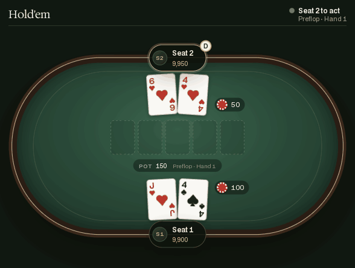{ loading=lazy }
<figcaption>HeadsUpHoldem-v0</figcaption>
</figure>
<figure markdown>
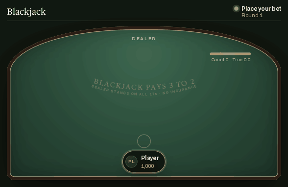{ loading=lazy }
<figcaption>Blackjack-v0</figcaption>
</figure>
</div>

[Chess, go, xiangqi, heads-up no-limit hold'em and blackjack](games.md), with the encodings
of AlphaZero: the player to act sees the game from its side, the legal moves come as a
mask, and rewards come at the end for the player who just moved, so one network plays both
sides of a [self-play](../guide/games.md) game. The board games have `clone()` for tree
search, and every game has an RGB and a text renderer.

| Environment | Players | Hidden information | Records |
|---|---|---|---|
| [`Chess-v0`](games.md#chess) | two (self-play), or one against an opponent | — | FEN, SAN, PGN |
| [`Go9x9-v0`, `Go13x13-v0`, `Go19x19-v0`](games.md#go) | two (self-play) | — | GTP vertices, SGF |
| [`Xiangqi-v0`](games.md#xiangqi) | two (self-play) | — | FEN, UCCI, WXF and Chinese notation |
| [`HeadsUpHoldem-v0`](games.md#heads-up-no-limit-holdem) | two (self-play) | the opponent's cards and the deck | hand histories |
| [`Blackjack-v0`](games.md#blackjack) | one, against the dealer | the dealer's hole card and the shoe | |

## Adding your own

Write a `sekai.Env` ([guide](../guide/environments.md#writing-an-environment)), validate it
with [`check_env`](../guide/checking.md) and [register](../guide/registry.md) it; it then
shows up in `sekai list` and works with `make()`, `make_vec()` and the CLI like the built-ins.
