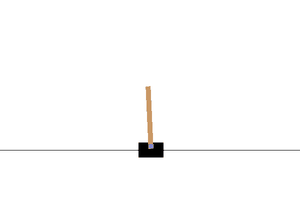
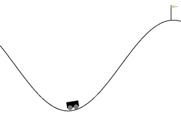
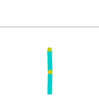

# Rendering

sekai environments have no `render()` method and no `render_mode`. Rendering is done by a
separate **renderer** object that reads an environment's state and returns a frame. Training
code never pays for rendering it does not use, one env can be drawn by several renderers, and
recording is a wrapper you add or remove without touching the environment.

<div class="sk-gallery" markdown>
<figure markdown>
{ loading=lazy }
<figcaption>CartPoleRenderer</figcaption>
</figure>
<figure markdown>
{ loading=lazy }
<figcaption>MountainCarRenderer</figcaption>
</figure>
<figure markdown>
{ loading=lazy }
<figcaption>PendulumRenderer</figcaption>
</figure>
<figure markdown>
{ loading=lazy }
<figcaption>AcrobotRenderer</figcaption>
</figure>
</div>

*These GIFs were produced by the renderers on this page, with `RecordFrames` and
`save_gif()`.*

## The Renderer protocol

A renderer has two methods:

| Method | Returns |
|---|---|
| `render(env)` | an RGB frame (`np.ndarray`, shape `(H, W, 3)`, `uint8`) or a text frame (`str`) |
| `close()` | releases resources (windows, figures, file handles) |

`sekai.rendering.Renderer` is a runtime-checkable `typing.Protocol`, so any object with those
two methods works (and passes `isinstance(obj, Renderer)`). Subclass
`sekai.rendering.BaseRenderer` to get a no-op `close()` and `with renderer:` support, which
calls `close()` on exit; the built-in renderers do.

## Built-in renderers

The classic-control environments come with RGB renderers that mirror gymnasium's
`rgb_array` output, drawn with sekai's own [`Canvas`](#canvas) (no pygame needed):

| Renderer | Draws | Frame size |
|---|---|---|
| `CartPoleRenderer(width=600, height=400)` | `CartPole-v1` | `(height, width, 3)` |
| `MountainCarRenderer(width=600, height=400)` | `MountainCar-v0`, `MountainCarContinuous-v0` | `(height, width, 3)` |
| `PendulumRenderer(size=500)` | `Pendulum-v1` | `(size, size, 3)` |
| `AcrobotRenderer(size=500)` | `Acrobot-v1` | `(size, size, 3)` |

They live in `sekai.envs.classic_control`, accept a wrapped or unwrapped env, raise
`ResetRequired` before the first `reset()` and `TypeError` for the wrong kind of env.

```python
import numpy as np
import sekai
from sekai.envs.classic_control import CartPoleRenderer

env = sekai.make("CartPole-v1")
renderer = CartPoleRenderer()
env.reset(seed=0)
frame = renderer.render(env)
print(frame.shape, frame.dtype)  # (400, 600, 3) uint8
```

## Recording frames

`RecordFrames` (in `sekai.rendering`) calls a renderer after every `reset()` and `step()`
and keeps the frames in `env.frames`:

```python
from sekai.envs.classic_control import PendulumRenderer
from sekai.rendering import RecordFrames

env = RecordFrames(sekai.make("Pendulum-v1"), PendulumRenderer(size=200))
env.action_space.seed(0)
result = env.reset(seed=0)
while not result.done:
    result = env.step(env.action_space.sample())

print(len(env.frames), env.frames[0].shape)  # 201 (200, 200, 3)
path = env.save("pendulum.gif")              # fps defaults to env.metadata["render_fps"]
print(path)  # pendulum.gif
env.close()                                  # closes the renderer too
```

| Option / method | Effect |
|---|---|
| `enabled=True` | set `env.enabled = False` to pause recording |
| `max_frames=None` | stop capturing after this many frames |
| `clear()` | drop the captured frames, e.g. between episodes |
| `save(path, fps=None)` | `.gif` via Pillow, anything else (e.g. `.mp4`) via imageio |

`save()` needs RGB array frames: frames recorded from a text (`"ansi"`) renderer raise
`TypeError`.

## Saving GIFs and videos

`save_gif(frames, path, fps=30)` and `save_video(frames, path, fps=30)` write a list of RGB
frames of shape `(H, W, 3)`, or one stacked `(T, H, W, 3)` array; greyscale `(H, W)` and RGBA
`(H, W, 4)` frames work too. `fps` must be positive. Anything else raises before a file is
written: `ValueError` for an empty list, a single frame passed instead of a list, a bad shape
or `fps`, and `TypeError` for text frames. GIFs need
Pillow; videos need imageio with its ffmpeg plugin. Both come with
`pip install "sekai[render]"`.

```python
from sekai.rendering import save_gif

env = sekai.make("CartPole-v1")
renderer = CartPoleRenderer(width=300, height=200)
env.reset(seed=0)
frames = [renderer.render(env)]
for _ in range(20):
    env.step(1)  # keep pushing right
    frames.append(renderer.render(env))
print(save_gif(frames, "push_right.gif", fps=25))  # push_right.gif
```

```py
from sekai.rendering import save_video

save_video(frames, "cartpole.mp4", fps=50)   # needs imageio + imageio-ffmpeg
```

## Canvas

`sekai.rendering.Canvas` is a tiny, dependency-free RGB raster. The origin is at the
**bottom-left** with `y` pointing up (convenient for physics), shapes are filled by testing
pixel centres, and `to_array()` returns a copy of the `(H, W, 3)` `uint8` image.

| Method | Draws |
|---|---|
| `clear(color=(255, 255, 255))` | fills the canvas |
| `rect(left, bottom, right, top, color)` | an axis-aligned rectangle |
| `polygon(points, color)` | a filled polygon from `(x, y)` vertices |
| `circle(cx, cy, radius, color)` | a filled disc |
| `line(start, end, color, width=1.0)` | a segment |
| `polyline(points, color, width=1.0)` | connected segments |

`sekai.rendering.rotate(points, angle, origin=(0, 0))` rotates points counter-clockwise, for
drawing rotated bodies.

```python
from sekai.rendering import Canvas

canvas = Canvas(8, 4)
canvas.rect(0, 0, 4, 2, (0, 0, 0))  # bottom-left 4x2 block
print((canvas.to_array()[:, :, 0] == 0).astype(int))
```

```text
[[0 0 0 0 0 0 0 0]
 [0 0 0 0 0 0 0 0]
 [1 1 1 1 0 0 0 0]
 [1 1 1 1 0 0 0 0]]
```

## Writing a renderer

A renderer reads whatever public state the env exposes. Two renderers for
[`MarketMaking-v0`](../environments/finance.md#marketmaking-v0): an RGB gauge of inventory and
session progress, and a text ticker.

```python
from sekai.rendering import Renderer


class InventoryGauge(Renderer):
    """Green/red bar: inventory relative to the limit. Blue strip: session elapsed."""

    def __init__(self, width=300, height=60):
        self.width, self.height = width, height

    def render(self, env):
        mm = env.unwrapped
        canvas = Canvas(self.width, self.height)
        centre = self.width / 2
        end = centre + mm.inventory / mm.max_inventory * centre
        color = (46, 125, 50) if end >= centre else (198, 40, 40)
        canvas.rect(min(centre, end), 20, max(centre, end), 50, color)
        canvas.line((centre, 15), (centre, 55), (0, 0, 0))
        elapsed = 1 - mm.time_remaining / mm.total_time
        canvas.rect(0, 0, elapsed * self.width, 8, (63, 81, 181))
        return canvas.to_array()

    def close(self):
        pass


class Ticker(Renderer):
    def render(self, env):
        mm = env.unwrapped
        return f"t={mm.total_time - mm.time_remaining:.2f} mid={mm.mid:.2f} inv={mm.inventory:+d}"

    def close(self):
        pass


env = RecordFrames(sekai.make("MarketMaking-v0"), InventoryGauge())
ticker = Ticker()
result = env.reset(seed=0)
while not result.done:
    result = env.step(env.unwrapped.avellaneda_stoikov_action())
print(ticker.render(env))  # t=1.00 mid=99.93 inv=-1
print(len(env.frames), env.frames[-1].shape)  # 201 (60, 300, 3)
```

## With gymnasium

[`to_gymnasium(env, renderer=...)`](gymnasium.md#rendering) turns a renderer into a
gymnasium `render_mode="rgb_array"` (pass `render_mode="ansi"` for a text renderer), so
gymnasium's `RecordVideo` and similar tools work. `"human"` is not accepted, since a renderer
returns frames rather than drawing to a window; wrap the converted env in gymnasium's
`HumanRendering` to watch it. In the other direction, `GymnasiumRenderer` renders an
env brought in with `from_gymnasium()` by calling the gymnasium env's own `render()`.
