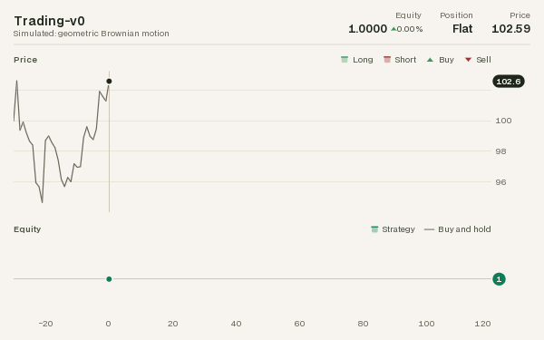
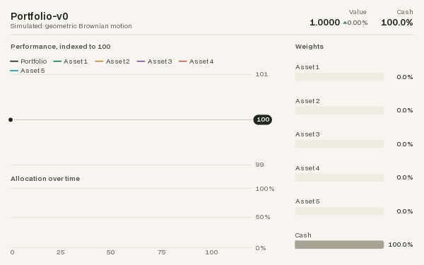
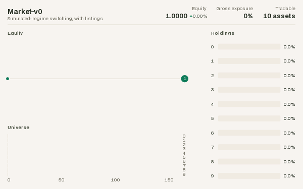
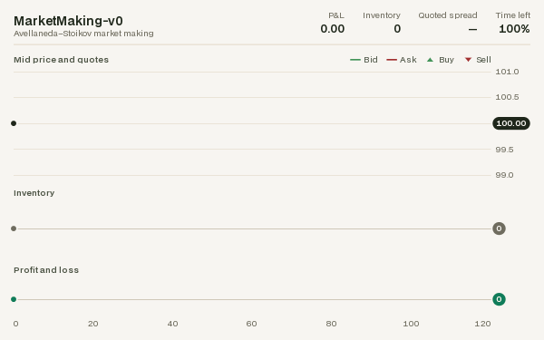
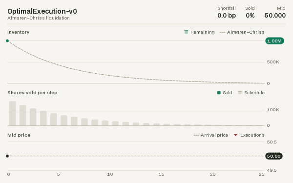
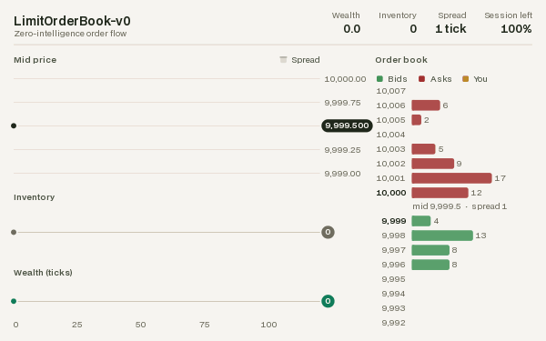

# Rendering

sekai environments have no `render()` method and no `render_mode`. Rendering is done by a
separate **renderer** object that reads an environment's state and returns a frame. Training
code never pays for rendering it does not use, one env can be drawn by several renderers, and
recording is a wrapper you add or remove without touching the environment.

<div class="sk-gallery" markdown>
<figure markdown>
{ loading=lazy }
<figcaption>CartPoleRenderer</figcaption>
</figure>
<figure markdown>
{ loading=lazy }
<figcaption>MountainCarRenderer</figcaption>
</figure>
<figure markdown>
{ loading=lazy }
<figcaption>PendulumRenderer</figcaption>
</figure>
<figure markdown>
{ loading=lazy }
<figcaption>AcrobotRenderer</figcaption>
</figure>
</div>

The finance environments are drawn as dashboards: the market, the agent's positions and
trades, and its results, as the episode unfolds.

<div class="sk-dashboards" markdown>
<figure markdown>
{ loading=lazy }
<figcaption>TradingRenderer</figcaption>
</figure>
<figure markdown>
{ loading=lazy }
<figcaption>PortfolioRenderer</figcaption>
</figure>
<figure markdown>
{ loading=lazy }
<figcaption>MarketRenderer</figcaption>
</figure>
<figure markdown>
{ loading=lazy }
<figcaption>MarketMakingRenderer</figcaption>
</figure>
<figure markdown>
{ loading=lazy }
<figcaption>OptimalExecutionRenderer</figcaption>
</figure>
<figure markdown>
{ loading=lazy }
<figcaption>LimitOrderBookRenderer</figcaption>
</figure>
</div>

*These GIFs were produced by the renderers on this page, with `RecordFrames` and
`save_gif()`; the finance ones by
[`examples/render_finance.py`](https://github.com/QianCapital/sekai/blob/master/examples/render_finance.py).*

## The Renderer protocol

A renderer has two methods:

| Method | Returns |
|---|---|
| `render(env)` | an RGB frame (`np.ndarray`, shape `(H, W, 3)`, `uint8`) or a text frame (`str`) |
| `close()` | releases resources (windows, figures, file handles) |

`sekai.rendering.Renderer` is a runtime-checkable `typing.Protocol`, so any object with those
two methods works (and passes `isinstance(obj, Renderer)`). Subclass
`sekai.rendering.BaseRenderer` to get a no-op `close()` and `with renderer:` support, which
calls `close()` on exit; the built-in renderers do.

## Built-in renderers

### Classic control

The classic-control environments come with RGB renderers that mirror gymnasium's
`rgb_array` output, drawn with sekai's own [`Canvas`](#canvas) (no pygame needed):

| Renderer | Draws | Frame size |
|---|---|---|
| `CartPoleRenderer(width=600, height=400)` | `CartPole-v1` | `(height, width, 3)` |
| `MountainCarRenderer(width=600, height=400)` | `MountainCar-v0`, `MountainCarContinuous-v0` | `(height, width, 3)` |
| `PendulumRenderer(size=500)` | `Pendulum-v1` | `(size, size, 3)` |
| `AcrobotRenderer(size=500)` | `Acrobot-v1` | `(size, size, 3)` |

They live in `sekai.envs.classic_control`, accept a wrapped or unwrapped env, raise
`ResetRequired` before the first `reset()` and `TypeError` for the wrong kind of env.

```python
import numpy as np
import sekai
from sekai.envs.classic_control import CartPoleRenderer

env = sekai.make("CartPole-v1")
renderer = CartPoleRenderer()
env.reset(seed=0)
frame = renderer.render(env)
print(frame.shape, frame.dtype)  # (400, 600, 3) uint8
```

### Finance

Every finance environment has a renderer in `sekai.envs.finance`. Each draws the episode so
far as a dashboard: a header with the environment's name, where its prices come from (the
date, for dated history) and its headline numbers, a progress rule along the episode, and
charts underneath.

| Renderer | Draws | Charts |
|---|---|---|
| `TradingRenderer` | `Trading-v0` | the price, with the lookback window before the episode, the position shaded behind it (long, short) and each trade marked; equity against buying and holding |
| `PortfolioRenderer` | `Portfolio-v0` | the portfolio and every asset indexed to 100; the allocation over time; the current weights |
| `MarketRenderer` | `Market-v0` | equity, with the simulated market's stressed regime shaded; the universe over time (which slots are tradable and held); the holdings |
| `MarketMakingRenderer` | `MarketMaking-v0` | the mid price with the bid and ask quotes and every fill; inventory; profit and loss |
| `OptimalExecutionRenderer` | `OptimalExecution-v0` | the shares left against the Almgren–Chriss schedule; shares sold per step; the mid price, execution prices and arrival price |
| `LimitOrderBookRenderer` | `LimitOrderBook-v0` | the mid price, spread and the agent's fills; inventory; wealth; the order book as a depth ladder, the agent's orders shown at their place in the queue |
| `LimitOrderBookMarketRenderer` | `LimitOrderBookMarket` | the same, with every trader in its own colour, over session time |

All of them take `width=720` and `height=450` (text and marks scale with the frame),
`theme="light"` or `"dark"` (see [Themes](#themes)) and `window=None` (an int shows only
the latest steps, a scrolling chart for long episodes); the two order-book renderers also
take `levels=8`, the price ticks shown on each side of the mid. Like the classic-control
renderers they accept a wrapped or unwrapped env and raise `TypeError` for the wrong kind.
They draw at 10 to 20 ms a frame.

```python
from sekai.envs.finance import TradingRenderer
from sekai.rendering import RecordFrames

env = RecordFrames(sekai.make("Trading-v0", episode_length=60), TradingRenderer())
result = env.reset(seed=0)
while not result.done:
    result = env.step(2)  # stay long
print(len(env.frames), env.frames[-1].shape)  # 61 (450, 720, 3)
env.save("trading.gif")
```

A renderer keeps the history of the episode it draws: every value it shows is recorded as
the frames are rendered, so render each step (as `RecordFrames` does) for complete charts.
It recognises a new episode from the env's `elapsed_steps` going back to 0, and one renderer
can draw several environments at once, keeping a history for each.
`LimitOrderBookMarket` is multi-agent, and `RecordFrames` wraps single-agent environments
only, so call `renderer.render(env)` after each step yourself.

## Recording frames

`RecordFrames` (in `sekai.rendering`) calls a renderer after every `reset()` and `step()`
and keeps the frames in `env.frames`:

```python
from sekai.envs.classic_control import PendulumRenderer
from sekai.rendering import RecordFrames

env = RecordFrames(sekai.make("Pendulum-v1"), PendulumRenderer(size=200))
env.action_space.seed(0)
result = env.reset(seed=0)
while not result.done:
    result = env.step(env.action_space.sample())

print(len(env.frames), env.frames[0].shape)  # 201 (200, 200, 3)
path = env.save("pendulum.gif")              # fps defaults to env.metadata["render_fps"]
print(path)  # pendulum.gif
env.close()                                  # closes the renderer too
```

| Option / method | Effect |
|---|---|
| `enabled=True` | set `env.enabled = False` to pause recording |
| `max_frames=None` | stop capturing after this many frames |
| `clear()` | drop the captured frames, e.g. between episodes |
| `save(path, fps=None)` | `.gif` via Pillow, anything else (e.g. `.mp4`) via imageio |

`save()` needs RGB array frames: frames recorded from a text (`"ansi"`) renderer raise
`TypeError`.

## Saving GIFs and videos

`save_gif(frames, path, fps=30)` and `save_video(frames, path, fps=30)` write a list of RGB
frames of shape `(H, W, 3)`, or one stacked `(T, H, W, 3)` array; greyscale `(H, W)` and RGBA
`(H, W, 4)` frames work too. All frames must have the same shape and integer pixel values in
`[0, 255]` (`uint8`, or any integer dtype within that range), and `fps` must be positive.
Anything else raises before a file is written: `ValueError` for an empty list, a single frame
passed instead of a list, a bad shape or `fps`, frames of different sizes, float frames (scale
an image in `[0, 1]` with `(frame * 255).round().astype(np.uint8)`) and values outside
`[0, 255]`, and `TypeError` for text frames. GIFs need Pillow; videos need imageio with its
ffmpeg plugin. Both come with `pip install "sekai[render]"`.

The frames of an RGB GIF share one 256-colour palette, so a pixel that does not change keeps
its colour from frame to frame and each frame stores only what changed: an animated chart
comes out about half the size, colours cannot flicker, and frames with at most 256 colours
in all (the classic-control renderers') are saved exactly.

```python
from sekai.rendering import save_gif

env = sekai.make("CartPole-v1")
renderer = CartPoleRenderer(width=300, height=200)
result = env.reset(seed=0)
frames = [renderer.render(env)]
while not result.done:
    result = env.step(1)  # keep pushing right, until the pole falls
    frames.append(renderer.render(env))
print(len(frames), save_gif(frames, "push_right.gif", fps=25))  # 9 push_right.gif
```

```py
from sekai.rendering import save_video

save_video(frames, "cartpole.mp4", fps=50)   # needs imageio + imageio-ffmpeg
```

## Dashboards for your own environments

The finance renderers are `sekai.rendering.Dashboard`s, assembled from charts that you can
use as well, so an environment of your own gets the same kind of renderer in a few lines.
A dashboard needs nothing from the environment but readable state:

```python
import numpy as np
import sekai
from sekai.finance.rendering import PriceChart
from sekai.rendering import Dashboard, LineChart, RecordFrames, Series, Stat


class SpreadTrading(sekai.Env):
    """Trade the spread of a cointegrated pair: long below zero, short above."""

    def __init__(self, episode_length=100):
        self.episode_length = episode_length
        self.observation_space = sekai.Box(-np.inf, np.inf, shape=(2,), dtype=np.float32)
        self.action_space = sekai.Discrete(3)  # short, flat, long

    def reset(self, *, seed=None, options=None):
        self._set_rng(seed)
        self.elapsed_steps, self.spread, self.position, self.pnl = 0, 0.0, 0.0, 0.0
        return sekai.ResetResult(self._obs(), {})

    def step(self, action):
        self.position = float(action) - 1.0
        move = -0.15 * self.spread + float(self.rng.normal(0, 0.3))
        self.pnl += self.position * move
        self.spread += move
        self.elapsed_steps += 1
        done = self.elapsed_steps >= self.episode_length
        return sekai.StepResult(self._obs(), self.position * move, False, done, {})

    def _obs(self):
        return np.array([self.spread, self.position], dtype=np.float32)


renderer = Dashboard(
    PriceChart("spread", position="position", reference=0.0, reference_label="Fair value",
               title="Spread", height=3),
    LineChart(Series("pnl", label="P&L", color="accent", fill=True), title="Profit and loss",
              baseline=0.0, height=2),
    title="Spread trading",
    subtitle="A custom environment",
    stats=[Stat("P&L", "pnl", "{:+.2f}"), Stat("Spread", "spread", "{:+.2f}")],
)
env = RecordFrames(SpreadTrading(), renderer)
result = env.reset(seed=0)
while not result.done:
    spread = env.unwrapped.spread
    result = env.step(2 if spread < -0.3 else 0 if spread > 0.3 else 1)
print(len(env.frames), env.frames[-1].shape)  # 101 (450, 720, 3)
env.save("spread_trading.gif")
```

**Sources.** Charts read the environment through sources: an attribute path on the unwrapped
env (`"pnl"`, `"book.best_bid"`; a method is not called), or a function of the env as passed
to `render()` (`lambda env: env.unwrapped.weights[:-1]`). A single attribute the base env
lacks is also looked up on its wrappers.

**Episodes and the time axis.** Each frame records the current value of every source, so a
chart shows the episode up to now. The clock is `step=` (default: the env's
`elapsed_steps`, through wrappers): a clock at 0, or one that goes backwards, starts a new
history, and rendering the same step twice redraws it without recording it again. Any number
works as a clock (`LimitOrderBookMarketRenderer` uses session time); with `step=None` every
render counts as a step and you call `renderer.reset()` between episodes. `horizon=` fixes
the end of the time axis so the episode draws from left to right; by default it is the
env's `episode_length` or `n_steps`, else the `max_episode_steps` of its spec, else the axis
grows with the episode. `window=` shows only the latest steps.

**Layout.** The positional arguments are stacked top to bottom. A list (or `Row(...)`) puts
charts side by side, `Column(...)` stacks them inside a row, and each chart's `width=` and
`height=` set its share (or pass `heights=` and `Row(..., widths=...)`). Time-series charts
share one time axis, labelled under the lowest chart of each column, and reserve a gutter on
the right for their y-axis labels so their plots line up.

**Header.** `title=` (default: the env's registered id or class name), `subtitle=` (a string
or a source, e.g. the date) and `stats=`, a list of `Stat(label, source, format, delta=...)`:
a headline number, with its change since the episode began when `delta="relative"` or
`"absolute"` (a direction triangle in the `up` or `down` colour; pass
`higher_is_better=False` for costs).

### Charts

| Chart | Shows |
|---|---|
| `LineChart(*series, baseline=, percent=, limits=, shade=)` | series over time on one axis; `Series(source, label=, color=, fill=, signed=, step=, dashed=, rebase=)` sets each line's look, `rebase=100` indexes it to 100 at the start, `shade=` a source that shades the steps where it is true |
| `BarChart(source, labels=, colors=, color=, available=, limit=)` | the current values of a vector as labelled bars (weights, holdings); `available=` greys out bars that cannot trade |
| `StackedArea(source, labels=, colors=)` | a vector over time as stacked areas (an allocation's composition) |
| `PriceChart(price, position=, quotes=, spread=, buys=, sells=, context=, reference=)` | a price with the agent's position shaded behind it, trades as triangles, its quotes, the market's spread band, the history before the episode and a reference level |
| `OrderBookChart(book, owners=, levels=)` | a `sekai.finance.OrderBook` as a depth ladder around the mid, with the orders of the owners you name highlighted at their place in each queue |
| `UniverseChart(weights, available=, labels=)` | a changing universe over time: one row per slot, filled while held, grey while tradable, empty while unlisted |

The first three live in `sekai.rendering`, the market charts in `sekai.finance.rendering`
(and `sekai.finance`). Colours are theme roles (`"accent"`, `"up"`, `"down"`, `"neutral"`,
`"highlight"`, `"price"`, ...), hex strings, RGB tuples or palette slots (`0` to `7`); left
out, the i-th series or bar takes palette slot i, so an asset keeps its colour in every chart.

### Custom panels

Subclass `sekai.rendering.Panel`: `sources()` names what to record each frame,
`draw(canvas, box, view)` draws it, reading the recorded values back from the `View`.
`frame()` draws the title (and a legend) and returns the plot area, and
`sekai.rendering.charts` has the pieces the built-in charts use: `Plot` (data to pixels,
gridlines, lines, areas, markers, value tags), `nice_ticks`, `tick_labels`, `format_number`.

```python
from sekai.rendering import Panel
from sekai.rendering.charts import Plot, nice_ticks, tick_labels


class Drawdown(Panel):
    """How far the P&L is below its running peak."""

    def sources(self):
        return {"pnl": "pnl"}  # recorded every frame, read back as view.values("pnl")

    def draw(self, canvas, box, view):
        pnl = view.values("pnl")
        drawdown = pnl - np.maximum.accumulate(pnl)
        area = self.frame(canvas, box, view)  # title row; returns the plot area
        low = min(float(drawdown.min()), -1.0) * 1.1
        plot = Plot(canvas, area, view.x_domain, (low, 0.0), view.theme, view.scale)
        ticks = nice_ticks(low, 0.0, 3)
        plot.grid(ticks, tick_labels(ticks))
        plot.area(view.steps, drawdown, view.theme.down, base=0.0, alpha=0.2)
        plot.line(view.steps, drawdown, view.theme.down)
        self.time_axis(plot, view)


renderer = Dashboard(
    LineChart(Series("pnl", label="P&L", fill=True), title="Profit and loss", baseline=0.0),
    Drawdown("Drawdown"),
    title="Spread trading",
)
```

A panel with `timeseries = False` (a class attribute) is not on the time axis, like
`BarChart` and `OrderBookChart`. `context()` names values to read once at the start of an
episode (`PriceChart` reads its lookback window this way), and `x_start(view)` lets a panel
start the shared time axis before the first step. A dashboard can also change its charts
after it is built, with `set_layout()`: the Portfolio renderer adds one line per asset when it
first sees an environment.

### Themes

`sekai.rendering.LIGHT` (the default) and `DARK` use the Qian Capital palette: warm paper or
a forest-ink surface, with forest-green and gold accents. A `Theme` names its colours by the
job they do: surface and ink (`background`, `grid`, `axis`, `text`, `text_secondary`,
`text_muted`), roles (`price`, `accent` for the series a chart is about, `neutral` for
benchmarks and cash, `highlight` for the agent's own orders), the polarity pair `up` /
`down` (long and short, buys and sells, bids and asks, gains and losses), and `series`, an
eight-colour categorical palette assigned in order and never cycled (a ninth series is drawn
in `neutral`).

Both palettes were checked for colour-vision deficiency: adjacent palette slots stay
distinguishable under protanopia and deuteranopia, and so do the first three slots in every
pair, as do the `up` and `down` colours. Charts never rely on colour alone either: trades are
triangles pointing up or down, bids sit below asks, and every chart with two or more series
has a legend.

```python
from sekai.rendering import DARK, LIGHT

renderer = TradingRenderer(theme="dark")
blue_up = LIGHT.with_colors(up="#2a78d6", down="#d95926")  # a blue/orange polarity pair
renderer = TradingRenderer(theme=blue_up)
```

## Canvas

`sekai.rendering.Canvas` is a tiny, dependency-free RGB raster. The origin is at the
**bottom-left** with `y` pointing up (convenient for physics), and `to_array()` returns a copy
of the `(H, W, 3)` `uint8` image. By default shapes are filled by testing pixel centres;
`Canvas(width, height, background, antialias=True)` draws every shape with exact coverage at
its edges instead (smooth lines and curves, rectangles on fractional pixels, round line caps
and joins), as the dashboards do.

| Method | Draws |
|---|---|
| `clear(color=(255, 255, 255))` | fills the canvas |
| `rect(left, bottom, right, top, color, radius=0)` | an axis-aligned rectangle, its corners rounded by `radius` |
| `polygon(points, color)` | a filled polygon from `(x, y)` vertices |
| `circle(cx, cy, radius, color)` | a filled disc |
| `line(start, end, color, width=1.0, dash=None)` | a segment; `dash=(on, off)` in pixels |
| `polyline(points, color, width=1.0, dash=None)` | connected segments; a NaN point leaves a gap |
| `fill_between(x, y1, y2, color)` | the area between two curves sampled at increasing `x` |
| `image(array, left, bottom, right, top)` | an RGB or RGBA image scaled into a box, each pixel a crisp block (heatmaps, matrices) |
| `text(x, y, text, color, size=12, bold=False, align="left", valign="baseline")` | a line of text; returns its width |

Every shape also takes `alpha=` (opacity in [0, 1]), and `with canvas.clip(left, bottom,
right, top):` restricts drawing to a rectangle. Text is set in BDO Grotesk, the typeface of
these pages, from glyphs rasterised ahead of time at 9 to 32 pixels (other sizes snap to the
nearest; larger ones are scaled) in a regular and a bold weight, with kerning and tabular
digits, so numbers that change from frame to frame keep their width. The glyphs ship with
sekai under the SIL Open Font License; `sekai.rendering.text_width(text, size, bold)`
measures text before you draw it.

`sekai.rendering.rotate(points, angle, origin=(0, 0))` rotates points counter-clockwise, for
drawing rotated bodies.

```python
from sekai.rendering import Canvas

canvas = Canvas(8, 4)
canvas.rect(0, 0, 4, 2, (0, 0, 0))  # bottom-left 4x2 block
print((canvas.to_array()[:, :, 0] == 0).astype(int))
```

```text
[[0 0 0 0 0 0 0 0]
 [0 0 0 0 0 0 0 0]
 [1 1 1 1 0 0 0 0]
 [1 1 1 1 0 0 0 0]]
```

## Writing a renderer

A renderer reads whatever public state the env exposes. Two renderers for
[`MarketMaking-v0`](../environments/finance.md#marketmaking-v0): an RGB gauge of inventory and
session progress, and a text ticker.

```python
from sekai.rendering import Renderer


class InventoryGauge(Renderer):
    """Green/red bar: inventory relative to the limit. Blue strip: session elapsed."""

    def __init__(self, width=300, height=60):
        self.width, self.height = width, height

    def render(self, env):
        mm = env.unwrapped
        canvas = Canvas(self.width, self.height)
        centre = self.width / 2
        end = centre + mm.inventory / mm.max_inventory * centre
        color = (46, 125, 50) if end >= centre else (198, 40, 40)
        canvas.rect(min(centre, end), 20, max(centre, end), 50, color)
        canvas.line((centre, 15), (centre, 55), (0, 0, 0))
        elapsed = 1 - mm.time_remaining / mm.total_time
        canvas.rect(0, 0, elapsed * self.width, 8, (63, 81, 181))
        return canvas.to_array()

    def close(self):
        pass


class Ticker(Renderer):
    def render(self, env):
        mm = env.unwrapped
        return f"t={mm.total_time - mm.time_remaining:.2f} mid={mm.mid:.2f} inv={mm.inventory:+d}"

    def close(self):
        pass


env = RecordFrames(sekai.make("MarketMaking-v0"), InventoryGauge())
ticker = Ticker()
result = env.reset(seed=0)
while not result.done:
    result = env.step(env.unwrapped.avellaneda_stoikov_action())
print(ticker.render(env))  # t=1.00 mid=99.93 inv=-1
print(len(env.frames), env.frames[-1].shape)  # 201 (60, 300, 3)
```

For a renderer that follows a whole episode, build a [dashboard](#dashboards-for-your-own-environments)
instead: it records the history for you.

## With gymnasium

[`to_gymnasium(env, renderer=...)`](gymnasium.md#rendering) turns a renderer into a
gymnasium `render_mode="rgb_array"` (pass `render_mode="ansi"` for a text renderer), so
gymnasium's `RecordVideo` and similar tools work. `"human"` is not accepted, since a renderer
returns frames rather than drawing to a window; wrap the converted env in gymnasium's
`HumanRendering` to watch it. In the other direction, `GymnasiumRenderer` renders an
env brought in with `from_gymnasium()` by calling the gymnasium env's own `render()` (for
gymnasium's classic-control envs that needs pygame: `pip install "gymnasium[classic-control]"`).
